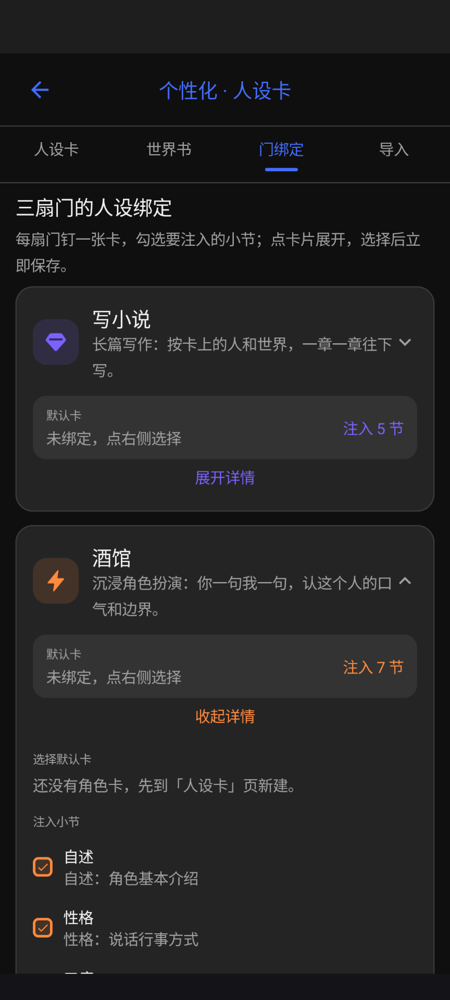
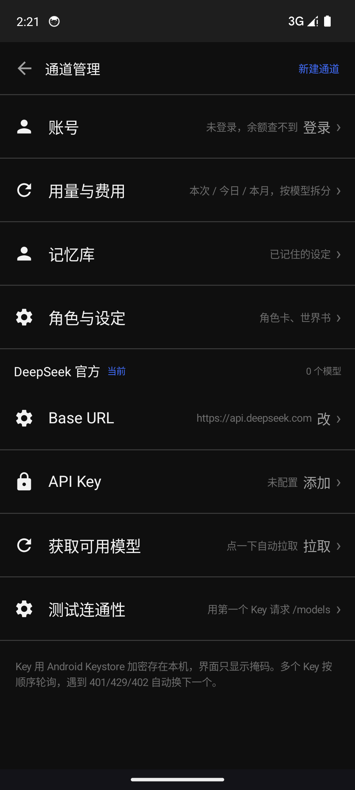
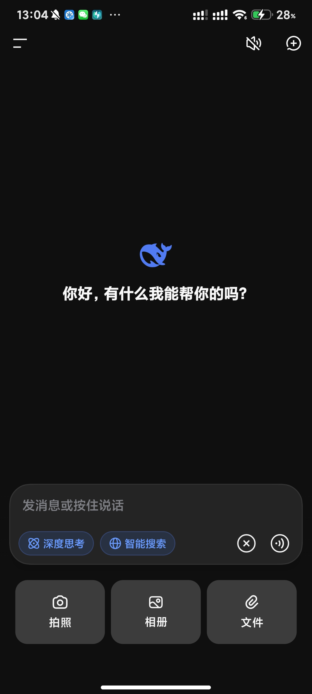
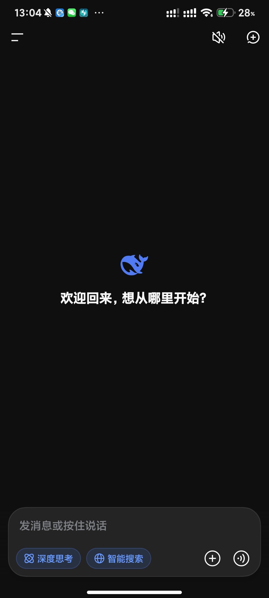

# DeepChat · Android + iOS 客户端

DeepChat 是一个能写长篇小说、能跑角色扮演的 DeepSeek 客户端。

官方 App 做不了这两件事：它没有角色卡，没有世界书，也不会记得你第三章埋的伏笔。这里补上了——聊到第十章还记得第一章的设定，角色不会被一句「作为 AI 助手」拽回通用问答。

**对话、四种写作模式、写作五动作、会话库、导入导出、朗读、用量统计全部免费，不限次数、不限期限。** 角色卡、世界书、酒馆模式、长期记忆、技能库是作者自己加的那部分，赞助 1 元开放。装完不付钱也能一直用。

两个平台各自原生实现，共用同一套兑换码与同一把验签公钥：

| 平台 | 语言与框架 | 包 | 文档 |
|---|---|---|---|
| Android | Kotlin + Jetpack Compose | `DeepChat-Writer-1.4.1.apk` | 本文 |
| iOS | Swift + SwiftUI（无第三方依赖） | `DeepChat-1.3.0-unsigned.ipa` / `-trollstore.ipa`（1.40 MB / 1.44 MB） | [README-iOS.md](README-iOS.md) |

- Android 包名：`com.DeepChat.hulibuld`
- Android 当前版本：**1.4.1**（versionCode 33）
- Android 最低系统：Android 8.0（API 26）· 目标 Android 14（API 34）
- iOS Bundle ID：`com.deepchat.hulibuld` · 版本 **1.3.0**（Build 4）· 最低 iOS 16

---

## 主要功能

### 1. 角色卡与世界书（官方没有）

长篇最怕的不是写不出来，是写到第十章时设定自己先乱了。

- **角色卡**：人设、说话习惯、忌讳分层存，开新会话不用重新交代，聊到第三十轮他还是他。
- **世界书**：地名、门派、时间线、势力关系单独成册，按 `scanDepth` / `depth` / `sticky` / `cooldown` 触发——写到哪带哪，不占无关篇幅。
- 两者都本机保存，可随 `.ycbak` 导出迁移。

### 2. 酒馆模式（官方没有）

角色扮演专用入口。载入角色卡与世界书，按设定推进剧情；内置 Author's Note 锚住语气，不会聊两轮就漂回通用助手口吻。

### 3. 长期记忆（官方没有）

- 每两轮对话触发一次提取，由模型自行判断属于「单会话记忆」还是「跨会话记忆」。
- 记忆库可查看、可编辑、可删除、可改归属；跨会话记忆在任意新会话中复用。

### 4. 技能库（官方没有）

28 项技能，按目录索引 + 按需加载——不是把所有提示词一次性塞进上下文。AI 自己判断该用哪一项，也可以在对话里手动指定。

### 5. 双写作模式与四种模式

输入区一键切换，各自绑定默认模型与采样参数：

| 模式 | 用途 |
|---|---|
| 普通 | 日常问答与短改 |
| 专家 | 需要更强指令跟随的改写 |
| 深度思考 | 结构梳理、长文推演 |
| 智能搜索 | 需要外部信息时 |

写作五动作另在回复下方：收紧、展开、加细节、改对话、列结构。

### 6. 双通道接入

- **账号通道**：应用内完成登录后自动接管登录态，凭证以系统级密钥库（AES-256/GCM）加密落盘，界面只显示掩码。
- **密钥通道**：可自填接口密钥，支持多把密钥组成密钥池，遇到 401 / 402 / 429 自动切换到下一把；每个通道可单独填写自定义服务端地址（兼容通用对话补全接口）。
- 通道管理支持多通道、每通道多密钥、按场景（小说 / 酒馆 / 记忆提取 / 翻译）分别绑定。

### 7. 记忆的存储与迁移

- 每两轮对话触发一次记忆提取，由模型自行判断该条内容属于「单会话记忆」还是「跨会话记忆」。
- 记忆库可查看、可编辑、可删除、可改归属；跨会话记忆在任意新会话中复用。
- 角色设定与世界观（角色卡、世界书）同样本机保存，可导出随备份迁移。

### 8. 思考过程翻译

- 模型返回的思考内容按设置中的目标语言自动翻译，展开「已深度思考」时默认显示译文。
- 「查看原文 / 查看译文」一键切换；译文与原文都写入本地库，重启不重译；目标语言与源语言相同时自动跳过。

### 9. 会话导入（三条路径）

1. **一键导入**：授予一次「所有文件访问」后扫描下载目录，自动识别导出包并导入，无需逐个选文件。
2. **自动导入**：每次打开应用时静默扫描新增导出包，导入后按会话 ID 去重，重复包只跳过不重复导入。
3. **手动导入**：走系统文件选择器选择单个文件。

导入全程本机解析：识别多分支会话树并按最深链还原主干，保留思考记录与内嵌图片，导入后自动归类并触发一次记忆提取。

### 10. 备份与数据管理

- 导出为 `.ycbak` 归档（清单 / 会话 / 消息 / 记忆 / 角色 / 世界书），可选密码加密（PBKDF2 派生 + AES-256-GCM）。
- 支持清空本地内容、按会话导出、删除单条消息。

### 11. 用量与费用

- 统计本次会话 / 今日 / 本月的调用量与费用，按模型拆分，单价可手动修正，支持月度预算提醒。

### 12. 免费、试用与赞助

分三层，判定只有一处（prompt 组装层），不在 UI 层按功能名逐个判：

| 层级 | 条件 | 角色卡等自研功能 |
|---|---|---|
| 免费 | 默认 | 不注入 |
| 试用 | 点「试用 1 天」后 24 小时内 | 与赞助后完全同权 |
| 赞助 | 一枚有效兑换码 | 注入 |

**免费版不是试用版**：对话、四种模式、写作五动作、会话库、导入导出、朗读、用量统计、Author's Note 全部免费且不限次数，没有期限，也不弹兑换框拦在前面。

**到期或未赞助的表现是「内容层」而不是「行为层」**：你写过的角色卡、会话记录、世界书条目一条不少，随时能导出；聊天照常发得出去，只是这些设定不再带进上下文。不会打码历史、不会灰掉会话、不会禁止发送。

授权凭证采用非对称签名（P-256），验签在客户端本机完成，服务端不下发任何私密内容；首次激活需联网登记设备号，之后离线可用。

### 12.1 试用与设备

- 1 天试用点按钮才计时，装完不运行不消耗。
- 清空应用数据可以重置试用——刻意不防。试用只有一次靠的是体验本身，不靠技术手段。
- 换设备会重新判定，因此换手机重复领取这条路走不通。
- 设备号首选 `ANDROID_ID`，附带旧 UUID 作候选，老用户升级后不会因换算法而失效。

### 13. 权限与隐私

- 仅申请 `INTERNET` 与 `ACCESS_NETWORK_STATE`；文件读写全部通过系统文件选择器（SAF）完成，不申请存储权限。
- 会话、记忆、角色卡、备份全部存放在应用私有目录，不上传任何服务器；除用户自行配置的模型接口外无其它出网行为。

---

## 安装方式

1. 从下载站或作者处获取最新的 `DeepChat-Writer-1.4.1.apk`（见 [RELEASE.md](RELEASE.md)）。
2. 在系统设置中允许「安装未知来源应用」（Android 8 及以上按应用授权一次即可）。
3. 安装后首次启动按引导页完成初始化，填好自己的接口密钥就能开始写。想用角色卡、世界书、酒馆模式时，按提示点「试用 1 天」或去「兑换码」页激活。
4. 打开「设置 → 通道管理」，填入自己的接口密钥或完成账号登录，即可开始写作。

升级时直接覆盖安装即可，本地数据与授权状态保留；跨版本升级前建议先在「数据管理」里导出一份 `.ycbak` 备份。

> 本项目以侧载方式分发，未在任何应用商店上架。请只从本站或作者公布的地址下载，避免使用二次打包的安装包。

---

## 截图

**对话主界面**



**首页工作台**



**设备截图**





---

## 构建方式

工程为原生 Android 项目（Kotlin + 声明式 UI），构建环境要求：

- JDK 17
- Android SDK（compileSdk 34 / build-tools 34.0.0）
- Gradle 8.7

```bash
# 1. 配置本机 SDK 路径（local.properties 不入库）
printf 'sdk.dir=%s\n' "$ANDROID_HOME" > local.properties

# 2. 调试包
./gradlew :app:assembleDebug

# 3. 发布包（签名参数由本地 keystore.properties 提供，不入库）
./gradlew :app:assembleRelease
```

发布包签名所需的密钥库、口令文件与服务端配置**不在本仓库内**，需要作者本机私有环境提供；仓库里的构建脚本在缺少这些文件时会退化为无签名构建产物，仅供调试。

---

## iOS 构建

iOS 版是独立的 SwiftUI 工程，源码在 [`ios/`](ios/)，没有第三方依赖。需要 Xcode（免费，装完提供 iOS SDK）与 xcodegen：

```bash
brew install xcodegen
cd ios
./build-ipa.sh          # 产出 dist/DeepChat-<版本>-unsigned.ipa 与 -trollstore.ipa
```

`build-ipa.sh` 做四件事：`xcodegen generate` 生成工程、`xcodebuild` 出 arm64 Release 包、压成通用未签名 `.ipa`、再用 ad-hoc 签名加 `platform-application` 出 TrollStore 专用包。逐条安装步骤见 [README-iOS.md](README-iOS.md)。

---

## 版本记录

| 版本 | 要点 |
|---|---|
| **1.4.1** | **免费版真正可用**：授权判定从生成闸门移到 prompt 组装层，没付费的用户不再被拦在门外；1 天试用（点按钮才计时）；R8 混淆与资源裁剪（原类名在 dex 里 0 命中）；移除内置中文字体改用系统字体；字号五档滑块；技能库 28 项按需加载；应用内更新检查；27 家服务商预设 |
| 1.4.0-blend | 修混淆保留规则：`-keep` 曾用旧包名，R8 可裁剪或改名全部类；已逐项核对 dex |
| 1.4.0 | 语音输入（系统识别，不上传音频）、字号四档、浅色主题、思考内容自动折叠；应用名改为 DeepChat |
| iOS 1.3.0 | 语音输入（SFSpeechRecognizer 实时识别，音频不留存）、字号四档、浅色主题、思考内容自动折叠 |
| iOS 1.2.0 | 包名与 Keychain service 改为 `com.deepchat.hulibuld`；首激活联网登记设备（`/bind`）；新增使用须知页（首次启动拦截 + 设置常驻入口） |
| iOS 1.1.0 | 补酒馆模式与世界书、图片与文件附件、JSON 会话导入；本地文件加系统级加密保护；加越狱与调试只读判定 |
| iOS 1.0.0 | iOS 首版：对话四模式、写作五动作、会话库、角色卡、记忆、用量、导出、多通道、朗读、兑换码与 Android 同源 |
| 1.3.0 | 包名改为 `com.DeepChat.hulibuld`；首激活联网登记设备；新增使用须知页。老版本与本版是两个不同的应用，需卸载重装并按新设备号换签 |
| 1.2.13 |凭证加密失败不再回落明文、读取路径关掉明文直通（含一次性迁移）、服务端地址只认 https、关掉明文传输、删掉从未生效的每日限额 |
| 1.2.12 | 授权凭证设备校验统一走 deviceMatches() |
| 1.2.10 | 激活流程与导入去重稳定性修复 |
| 1.2.9 | 发布流程调整 |
| 1.2.8 | 独立下载站与发布说明上线 |
| 1.2.5 | 一键导入与自动导入落地 |
| 1.2.4 | 思考过程翻译落库、原文/译文切换 |
| 1.1.3 | 双写作模式、通道管理、记忆库、用量计费首个完整版 |

---

## 使用须知与免责声明

本项目是第三方客户端，与 DeepSeek、OpenAI 等无隶属关系；聊天走你自己的 API Key，不经过中转服务器。对话与写作功能免费提供；角色卡、世界书、酒馆模式、长期记忆、技能库由作者自行开发，需赞助 1 元开放，性质是对开发工作的自愿支持。完整条款见 [DISCLAIMER.md](DISCLAIMER.md)。

---

## 仓库说明

本仓库用于公开项目介绍、版本记录、使用文档与可公开的源码/构建说明。**保密内容（签名私钥、兑换码表、云端密钥、服务端配置、实测记录）永不上传**，边界见 [PUBLISH-CHECKLIST.md](PUBLISH-CHECKLIST.md)。

---

## 联系作者

- 抖音：`_I36_567I_5193_`
- 爱发电（赞助 1 元开放角色扮演全套）：<https://afdian.com/item/c77ca3c2e75211f18cd252540025c377>
- 问题反馈：在本仓库提 Issue，或通过上述渠道留言。

---

© DeepChat。保留所有权利。